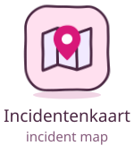
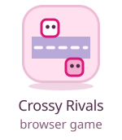
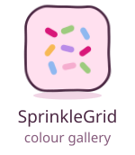
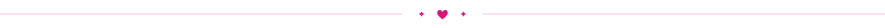

<picture><source media="(prefers-color-scheme: dark)" srcset="assets/header-dark.svg"></picture>

<!-- live:stats -->

<b>12</b> active days this month, so the plant has 7 blossoms &nbsp;·&nbsp; <b>123</b> contributions this year

<!-- /live:stats -->

<a href="https://incidentenkaart.nl"><picture><source media="(prefers-color-scheme: dark)" srcset="assets/app-map-dark.svg"></picture></a>&nbsp;<a href="https://crossyrivals.com"><picture><source media="(prefers-color-scheme: dark)" srcset="assets/app-road-dark.svg"></picture></a>&nbsp;<a href="https://sprinklegrid.nl"><picture><source media="(prefers-color-scheme: dark)" srcset="assets/app-sprinkles-dark.svg"></picture></a>

<!-- live:lately -->

8 pull requests merged in other people's projects so far, 9 still waiting. The newest (filled heart = merged):

 &nbsp;<a href="https://github.com/KartikLabhshetwar/better-shot/pull/199"><b>KartikLabhshetwar/better-shot</b> #199</a> &nbsp;Fix deleting share links created with direct file links 
 &nbsp;<a href="https://github.com/giovannicoppola/alfred-aeye/pull/4"><b>giovannicoppola/alfred-aeye</b> #4</a> &nbsp;Show the Claude Fable weekly limit as its own row (0.3.0) 
 &nbsp;<a href="https://github.com/crmne/zapfast/pull/770"><b>crmne/zapfast</b> #770</a> &nbsp;Add Dutch interface translation 
 &nbsp;<a href="https://github.com/crmne/fastframe/pull/70"><b>crmne/fastframe</b> #70</a> &nbsp;Use Metal as the first renderer on macOS with wgpu

<!-- /live:lately -->

<picture><source media="(prefers-color-scheme: dark)" srcset="assets/divider-dark.svg"></picture>

say hi: <a href="https://myselfhosted.eu">myselfhosted.eu</a> ♡

