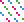

<picture><source media="(prefers-color-scheme: dark)" srcset="assets/pet-dark.svg"></picture>

### hi, i'm TheDutchSmoke ♡

<!-- live:mood -->

This is <b>puff</b>, a little smoke puff that lives on my commits and pull requests. Today puff is <b>happy & well fed</b>: 9 contributions this week, 123 this year, and 8 pull requests merged in other people's projects so far.

<!-- /live:mood -->

<!-- live:lately -->

puff's food log, my newest pull requests in other people's projects (full heart = merged): 
 <a href="https://github.com/KartikLabhshetwar/better-shot/pull/199"><b>better-shot</b> #199</a> Fix deleting share links created with… 
 <a href="https://github.com/giovannicoppola/alfred-aeye/pull/4"><b>alfred-aeye</b> #4</a> Show the Claude Fable weekly limit as… 
 <a href="https://github.com/crmne/zapfast/pull/770"><b>zapfast</b> #770</a> Add Dutch interface translation

<!-- /live:lately -->

 

 &nbsp;<a href="https://incidentenkaart.nl"><b>Incidentenkaart</b></a>, incident reports in the Netherlands on one map 
 &nbsp;<a href="https://crossyrivals.com"><b>Crossy Rivals</b></a>, a Crossy Road-style browser game for up to 20 players 
 &nbsp;<a href="https://sprinklegrid.nl"><b>SprinkleGrid</b></a>, a colourful gallery experiment with seasonal themes

<picture><source media="(prefers-color-scheme: dark)" srcset="assets/divider-dark.svg"></picture>

say hi: <a href="https://myselfhosted.eu">myselfhosted.eu</a> ♡

