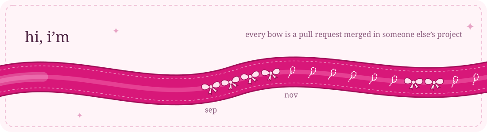
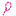
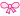
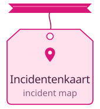
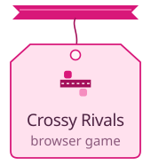
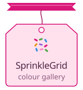
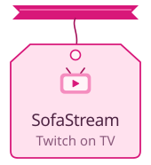
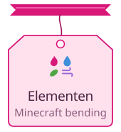
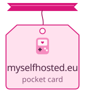

<picture><source media="(prefers-color-scheme: dark)" srcset="assets/header-dark.svg"></picture>

I like having my own little corner of the internet and making it feel like mine. I run a couple of small servers, build tools and games for fun, and now and then translate an app I love into Dutch.

<!-- live:lately -->

8 bows and 9 loose loops so far, across 12 projects. The newest knots: 
 &nbsp;<a href="https://github.com/KartikLabhshetwar/better-shot/pull/199"><b>KartikLabhshetwar/better-shot</b> #199</a> &nbsp;Fix deleting share links created with direct file links 
 &nbsp;<a href="https://github.com/giovannicoppola/alfred-aeye/pull/4"><b>giovannicoppola/alfred-aeye</b> #4</a> &nbsp;Show the Claude Fable weekly limit as its own row (0.3.0) 
 &nbsp;<a href="https://github.com/crmne/zapfast/pull/770"><b>crmne/zapfast</b> #770</a> &nbsp;Add Dutch interface translation 
 &nbsp;<a href="https://github.com/crmne/fastframe/pull/70"><b>crmne/fastframe</b> #70</a> &nbsp;Use Metal as the first renderer on macOS with wgpu 
 &nbsp;<a href="https://github.com/crmne/spotifast/pull/1244"><b>crmne/spotifast</b> #1244</a> &nbsp;Use Metal for smoother scrolling on macOS

I like helping out in other people's projects: <a href="https://github.com/KartikLabhshetwar/better-shot/pulls?q=is%3Apr+author%3ATheDutchSmoke">better-shot</a> · <a href="https://github.com/giovannicoppola/alfred-aeye/pulls?q=is%3Apr+author%3ATheDutchSmoke">alfred-aeye</a> · <a href="https://github.com/crmne/zapfast/pulls?q=is%3Apr+author%3ATheDutchSmoke">zapfast</a> · <a href="https://github.com/crmne/fastframe/pulls?q=is%3Apr+author%3ATheDutchSmoke">fastframe</a> · <a href="https://github.com/crmne/spotifast/pulls?q=is%3Apr+author%3ATheDutchSmoke">spotifast</a> · <a href="https://github.com/bilipp/Lume/pulls?q=is%3Apr+author%3ATheDutchSmoke">Lume</a> · <a href="https://github.com/crmne/winit/pulls?q=is%3Apr+author%3ATheDutchSmoke">winit</a> · <a href="https://github.com/bilipp/LumeCloud/pulls?q=is%3Apr+author%3ATheDutchSmoke">LumeCloud</a> · <a href="https://github.com/SakuraCordApp/SakuraCord/pulls?q=is%3Apr+author%3ATheDutchSmoke">SakuraCord</a> · <a href="https://github.com/chojs23/concord/pulls?q=is%3Apr+author%3ATheDutchSmoke">concord</a> · <a href="https://github.com/espanso/espanso/pulls?q=is%3Apr+author%3ATheDutchSmoke">espanso</a> · <a href="https://github.com/mennosanders/Redflag-extension/pulls?q=is%3Apr+author%3ATheDutchSmoke">Redflag-extension</a>.

<!-- /live:lately -->

 
my last 12 weeks in cross-stitch: one stitch per active day, the darker the busier

<!-- live:tags -->

&nbsp;&nbsp;&nbsp;&nbsp;&nbsp;

<!-- /live:tags -->

say hi: <a href="https://myselfhosted.eu">myselfhosted.eu</a> ♡ &nbsp;·&nbsp; the ribbon and the stitches update themselves every morning

