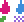

<picture><source media="(prefers-color-scheme: dark)" srcset="assets/pet-dark.svg"></picture>

### hi, i'm TheDutchSmoke ♡

I like having my own little corner of the internet and making it feel like mine. I run a couple of small servers, build tools and games for fun, and now and then translate an app I love into Dutch.

<!-- live:mood -->

This is <b>puff</b>, a little smoke puff that lives on my commits and pull requests. Today puff is <b>happy & well fed</b>: 9 contributions this week, 123 this year, and 8 pull requests merged in other people's projects so far.

<!-- /live:mood -->

 

<!-- live:projects -->

 &nbsp;<a href="https://incidentenkaart.nl"><b>Incidentenkaart</b></a>, incident reports in the Netherlands on one map, with traceable sources 
 &nbsp;<a href="https://crossyrivals.com"><b>Crossy Rivals</b></a>, a Crossy Road-style browser game for up to 20 players 
 &nbsp;<a href="https://sprinklegrid.nl"><b>SprinkleGrid</b></a>, a colourful gallery with seasonal themes 
 &nbsp;<a href="https://github.com/TheDutchSmoke/sofastream"><b>SofaStream</b></a>, Twitch on the Apple TV, started from a macOS terminal 
 &nbsp;<a href="https://github.com/TheDutchSmoke/elementen-resourcepack"><b>Elementen</b></a>, a bending adventure for my own Minecraft server 
 &nbsp;<a href="https://myselfhosted.eu"><b>myselfhosted.eu</b></a>, my pocket business card: a tiny handheld that boots into my accounts

<!-- /live:projects -->

puff's diary: my last 12 weeks, one bar per week, and puff on the busiest one

<!-- live:lately -->

puff's food log, my newest pull requests in other people's projects (full heart = merged): 
 <a href="https://github.com/KartikLabhshetwar/better-shot/pull/199"><b>better-shot</b> #199</a> Fix deleting share links created with… 
 <a href="https://github.com/giovannicoppola/alfred-aeye/pull/4"><b>alfred-aeye</b> #4</a> Show the Claude Fable weekly limit as… 
 <a href="https://github.com/crmne/zapfast/pull/770"><b>zapfast</b> #770</a> Add Dutch interface translation

<!-- /live:lately -->

<!-- live:helped -->

Projects I've helped out in: <a href="https://github.com/KartikLabhshetwar/better-shot/pulls?q=is%3Apr+author%3ATheDutchSmoke">better-shot</a> · <a href="https://github.com/giovannicoppola/alfred-aeye/pulls?q=is%3Apr+author%3ATheDutchSmoke">alfred-aeye</a> · <a href="https://github.com/crmne/zapfast/pulls?q=is%3Apr+author%3ATheDutchSmoke">zapfast</a> · <a href="https://github.com/crmne/fastframe/pulls?q=is%3Apr+author%3ATheDutchSmoke">fastframe</a> · <a href="https://github.com/crmne/spotifast/pulls?q=is%3Apr+author%3ATheDutchSmoke">spotifast</a> · <a href="https://github.com/bilipp/Lume/pulls?q=is%3Apr+author%3ATheDutchSmoke">Lume</a> · <a href="https://github.com/crmne/winit/pulls?q=is%3Apr+author%3ATheDutchSmoke">winit</a> · <a href="https://github.com/bilipp/LumeCloud/pulls?q=is%3Apr+author%3ATheDutchSmoke">LumeCloud</a> · <a href="https://github.com/SakuraCordApp/SakuraCord/pulls?q=is%3Apr+author%3ATheDutchSmoke">SakuraCord</a> · <a href="https://github.com/chojs23/concord/pulls?q=is%3Apr+author%3ATheDutchSmoke">concord</a> · <a href="https://github.com/espanso/espanso/pulls?q=is%3Apr+author%3ATheDutchSmoke">espanso</a> · <a href="https://github.com/mennosanders/Redflag-extension/pulls?q=is%3Apr+author%3ATheDutchSmoke">Redflag-extension</a>.

<!-- /live:helped -->

<picture><source media="(prefers-color-scheme: dark)" srcset="assets/divider-dark.svg"></picture>

say hi: <a href="https://myselfhosted.eu">myselfhosted.eu</a> ♡ &nbsp;·&nbsp; puff and the numbers update themselves every morning

