<picture><source media="(prefers-color-scheme: dark)" srcset="assets/header-dark.svg"></picture>

<!-- live:stats -->

<b>12</b> active days in the last month, so the plant has 7 blossoms &nbsp;·&nbsp; <b>123</b> contributions in the last year &nbsp;·&nbsp; <b>7</b> pull requests merged in other people's projects

<!-- /live:stats -->

I like having my own little corner of the internet and making it feel like mine. 
I run a couple of small servers, build tools and games for fun, and now and then translate an app I love into Dutch.

<!-- live:apps -->

<a href="https://incidentenkaart.nl"><picture><source media="(prefers-color-scheme: dark)" srcset="assets/app-map-dark.svg"></picture></a>&nbsp;<a href="https://crossyrivals.com"><picture><source media="(prefers-color-scheme: dark)" srcset="assets/app-road-dark.svg"></picture></a>&nbsp;<a href="https://sprinklegrid.nl"><picture><source media="(prefers-color-scheme: dark)" srcset="assets/app-sprinkles-dark.svg"></picture></a>&nbsp;<a href="https://github.com/TheDutchSmoke/sofastream"><picture><source media="(prefers-color-scheme: dark)" srcset="assets/app-tv-dark.svg"></picture></a>&nbsp;<a href="https://myselfhosted.eu"><picture><source media="(prefers-color-scheme: dark)" srcset="assets/app-console-dark.svg"></picture></a>

<!-- /live:apps -->

<picture><source media="(prefers-color-scheme: dark)" srcset="assets/pots-dark.svg"></picture>

my last 12 weeks, one pot per week: the busier the week, the taller the plant

<!-- live:lately -->

I also like helping out in other people's projects: <a href="https://github.com/KartikLabhshetwar/better-shot/pulls?q=is%3Apr+author%3ATheDutchSmoke">better-shot</a> · <a href="https://github.com/giovannicoppola/alfred-aeye/pulls?q=is%3Apr+author%3ATheDutchSmoke">alfred-aeye</a> · <a href="https://github.com/crmne/zapfast/pulls?q=is%3Apr+author%3ATheDutchSmoke">zapfast</a> · <a href="https://github.com/crmne/fastframe/pulls?q=is%3Apr+author%3ATheDutchSmoke">fastframe</a> · <a href="https://github.com/crmne/spotifast/pulls?q=is%3Apr+author%3ATheDutchSmoke">spotifast</a> · <a href="https://github.com/bilipp/Lume/pulls?q=is%3Apr+author%3ATheDutchSmoke">Lume</a> · <a href="https://github.com/crmne/winit/pulls?q=is%3Apr+author%3ATheDutchSmoke">winit</a> · <a href="https://github.com/bilipp/LumeCloud/pulls?q=is%3Apr+author%3ATheDutchSmoke">LumeCloud</a> · <a href="https://github.com/SakuraCordApp/SakuraCord/pulls?q=is%3Apr+author%3ATheDutchSmoke">SakuraCord</a> · <a href="https://github.com/chojs23/concord/pulls?q=is%3Apr+author%3ATheDutchSmoke">concord</a> · <a href="https://github.com/espanso/espanso/pulls?q=is%3Apr+author%3ATheDutchSmoke">espanso</a>.

<picture><source media="(prefers-color-scheme: dark)" srcset="assets/jar-dark.svg"></picture> 
what those pull requests are made of, counted in changed lines

the newest (filled heart = merged, outline = still waiting) 
 &nbsp;<a href="https://github.com/KartikLabhshetwar/better-shot/pull/199"><b>KartikLabhshetwar/better-shot</b> #199</a> &nbsp;Fix deleting share links created with direct file links 
 &nbsp;<a href="https://github.com/giovannicoppola/alfred-aeye/pull/4"><b>giovannicoppola/alfred-aeye</b> #4</a> &nbsp;Show the Claude Fable weekly limit as its own row (0.3.0) 
 &nbsp;<a href="https://github.com/crmne/zapfast/pull/770"><b>crmne/zapfast</b> #770</a> &nbsp;Add Dutch interface translation 
 &nbsp;<a href="https://github.com/crmne/fastframe/pull/70"><b>crmne/fastframe</b> #70</a> &nbsp;Use Metal as the first renderer on macOS with wgpu

<!-- /live:lately -->

<picture><source media="(prefers-color-scheme: dark)" srcset="assets/divider-dark.svg"></picture>

say hi: <a href="https://myselfhosted.eu">myselfhosted.eu</a> ♡

