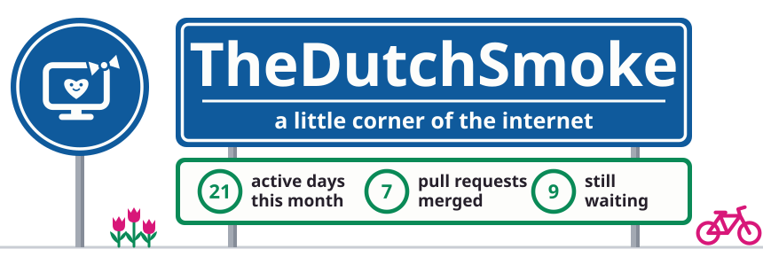
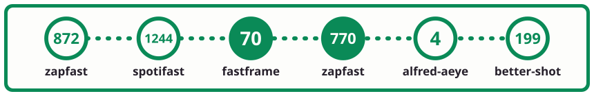
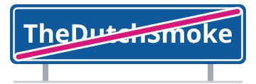

<!-- live:header -->
<picture><source media="(prefers-color-scheme: dark)" srcset="assets/sign-dark.svg"></picture>
<!-- /live:header -->

I like having my own little corner of the internet and making it feel like mine. 
I run a couple of small servers, build tools and games for fun, and now and then translate an app I love into Dutch.

<!-- live:projects -->

<a href="https://incidentenkaart.nl"><picture><source media="(prefers-color-scheme: dark)" srcset="assets/arm-map-dark.svg"></picture></a><a href="https://crossyrivals.com"><picture><source media="(prefers-color-scheme: dark)" srcset="assets/arm-road-dark.svg"></picture></a><a href="https://sprinklegrid.nl"><picture><source media="(prefers-color-scheme: dark)" srcset="assets/arm-sprinkles-dark.svg"></picture></a><a href="https://github.com/TheDutchSmoke/sofastream"><picture><source media="(prefers-color-scheme: dark)" srcset="assets/arm-tv-dark.svg"></picture></a><a href="https://myselfhosted.eu"><picture><source media="(prefers-color-scheme: dark)" srcset="assets/arm-console-dark.svg"></picture></a> 

<!-- /live:projects -->

<!-- live:counter -->
<picture><source media="(prefers-color-scheme: dark)" srcset="assets/counter-dark.svg"></picture>
<!-- /live:counter -->

<!-- live:route -->
<picture><source media="(prefers-color-scheme: dark)" srcset="assets/route-dark.svg"></picture>
<!-- /live:route -->

<!-- live:lately -->

my newest pull requests in other people's projects: a filled ring is merged, an open ring is still waiting 
<a href="https://github.com/KartikLabhshetwar/better-shot/pulls?q=is%3Apr+author%3ATheDutchSmoke">better-shot</a> · <a href="https://github.com/giovannicoppola/alfred-aeye/pulls?q=is%3Apr+author%3ATheDutchSmoke">alfred-aeye</a> · <a href="https://github.com/crmne/zapfast/pulls?q=is%3Apr+author%3ATheDutchSmoke">zapfast</a> · <a href="https://github.com/crmne/fastframe/pulls?q=is%3Apr+author%3ATheDutchSmoke">fastframe</a> · <a href="https://github.com/crmne/spotifast/pulls?q=is%3Apr+author%3ATheDutchSmoke">spotifast</a> · <a href="https://github.com/bilipp/Lume/pulls?q=is%3Apr+author%3ATheDutchSmoke">Lume</a> · <a href="https://github.com/crmne/winit/pulls?q=is%3Apr+author%3ATheDutchSmoke">winit</a> · <a href="https://github.com/bilipp/LumeCloud/pulls?q=is%3Apr+author%3ATheDutchSmoke">LumeCloud</a> · <a href="https://github.com/SakuraCordApp/SakuraCord/pulls?q=is%3Apr+author%3ATheDutchSmoke">SakuraCord</a> · <a href="https://github.com/chojs23/concord/pulls?q=is%3Apr+author%3ATheDutchSmoke">concord</a> · <a href="https://github.com/espanso/espanso/pulls?q=is%3Apr+author%3ATheDutchSmoke">espanso</a>

<!-- /live:lately -->

<!-- live:footer -->

<a href="https://myselfhosted.eu"><picture><source media="(prefers-color-scheme: dark)" srcset="assets/leaving-dark.svg"></picture></a> 
say hi: <a href="https://myselfhosted.eu">myselfhosted.eu</a> &nbsp;·&nbsp; <a href="https://github.com/TheDutchSmoke/TheDutchSmoke/issues/new?title=tring+tring&body=Just+press+the+green+button+to+ring+your+bike+bell+as+you+pass.&labels=bell">ring your bell as you pass</a>

<!-- /live:footer -->
