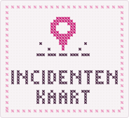
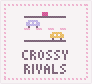
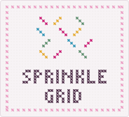
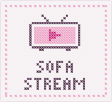
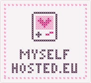
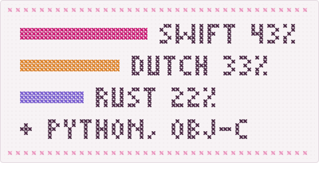

<!-- live:header -->
<picture><source media="(prefers-color-scheme: dark)" srcset="assets/sampler-dark.svg"></picture>
<!-- /live:header -->

<!-- live:stats -->

<b>21</b> busy days in the last month, one little column of stitches each &nbsp;·&nbsp; <b>1,111</b> contributions in the last year 
<b>7</b> pull requests merged and <b>9</b> still waiting in other people's projects

<!-- /live:stats -->

I like having my own little corner of the internet and making it feel like mine. 
I run a couple of small servers, build tools and games for fun, and now and then translate an app I love into Dutch.

<!-- live:projects -->

<a href="https://incidentenkaart.nl"><picture><source media="(prefers-color-scheme: dark)" srcset="assets/patch-map-dark.svg"></picture></a>&thinsp;<a href="https://crossyrivals.com"><picture><source media="(prefers-color-scheme: dark)" srcset="assets/patch-road-dark.svg"></picture></a>&thinsp;<a href="https://sprinklegrid.nl"><picture><source media="(prefers-color-scheme: dark)" srcset="assets/patch-sprinkles-dark.svg"></picture></a>&thinsp;<a href="https://github.com/TheDutchSmoke/sofastream"><picture><source media="(prefers-color-scheme: dark)" srcset="assets/patch-tv-dark.svg"></picture></a>&thinsp;<a href="https://myselfhosted.eu"><picture><source media="(prefers-color-scheme: dark)" srcset="assets/patch-console-dark.svg"></picture></a>

<!-- /live:projects -->

<!-- live:garden -->
<picture><source media="(prefers-color-scheme: dark)" srcset="assets/weeks-dark.svg"></picture>
<!-- /live:garden -->

<!-- live:lately -->

<picture><source media="(prefers-color-scheme: dark)" srcset="assets/floss-dark.svg"></picture>I also like helping out in other people's projects: <a href="https://github.com/KartikLabhshetwar/better-shot/pulls?q=is%3Apr+author%3ATheDutchSmoke">better-shot</a> · <a href="https://github.com/giovannicoppola/alfred-aeye/pulls?q=is%3Apr+author%3ATheDutchSmoke">alfred-aeye</a> · <a href="https://github.com/crmne/zapfast/pulls?q=is%3Apr+author%3ATheDutchSmoke">zapfast</a> · <a href="https://github.com/crmne/fastframe/pulls?q=is%3Apr+author%3ATheDutchSmoke">fastframe</a> · <a href="https://github.com/crmne/spotifast/pulls?q=is%3Apr+author%3ATheDutchSmoke">spotifast</a> · <a href="https://github.com/bilipp/Lume/pulls?q=is%3Apr+author%3ATheDutchSmoke">Lume</a> · <a href="https://github.com/crmne/winit/pulls?q=is%3Apr+author%3ATheDutchSmoke">winit</a> · <a href="https://github.com/bilipp/LumeCloud/pulls?q=is%3Apr+author%3ATheDutchSmoke">LumeCloud</a> · <a href="https://github.com/SakuraCordApp/SakuraCord/pulls?q=is%3Apr+author%3ATheDutchSmoke">SakuraCord</a> · <a href="https://github.com/chojs23/concord/pulls?q=is%3Apr+author%3ATheDutchSmoke">concord</a> · <a href="https://github.com/espanso/espanso/pulls?q=is%3Apr+author%3ATheDutchSmoke">espanso</a>.

the newest (filled heart = merged, outline = still waiting) 
<picture><source media="(prefers-color-scheme: dark)" srcset="assets/heart-open-dark.svg"></picture> &nbsp;<a href="https://github.com/KartikLabhshetwar/better-shot/pull/199"><b>better-shot</b> #199</a> &nbsp;Fix deleting share links created with direct file links 
<picture><source media="(prefers-color-scheme: dark)" srcset="assets/heart-open-dark.svg"></picture> &nbsp;<a href="https://github.com/giovannicoppola/alfred-aeye/pull/4"><b>alfred-aeye</b> #4</a> &nbsp;Show the Claude Fable weekly limit as its own row (0.3.0) 
<picture><source media="(prefers-color-scheme: dark)" srcset="assets/heart-merged-dark.svg"></picture> &nbsp;<a href="https://github.com/crmne/zapfast/pull/770"><b>zapfast</b> #770</a> &nbsp;Add Dutch interface translation 
<picture><source media="(prefers-color-scheme: dark)" srcset="assets/heart-merged-dark.svg"></picture> &nbsp;<a href="https://github.com/crmne/fastframe/pull/70"><b>fastframe</b> #70</a> &nbsp;Use Metal as the first renderer on macOS with wgpu

 
<!-- /live:lately -->

<!-- live:footer -->
<picture><source media="(prefers-color-scheme: dark)" srcset="assets/divider-dark.svg"></picture>

say hi: <a href="https://myselfhosted.eu">myselfhosted.eu</a> &nbsp;·&nbsp; <a href="https://github.com/TheDutchSmoke/TheDutchSmoke/issues/new?title=a+stitch+from+me&body=Just+press+the+green+button+and+the+sampler+gets+one+stitch+from+you.&labels=stitch">add a stitch ♡</a>

<!-- /live:footer -->
