<!-- live:header -->
<!-- /live:header -->

I like having my own little corner of the internet and making it feel like mine. 
I run a couple of small servers, build tools and games for fun, and now and then translate an app I love into Dutch.

<!-- live:projects -->

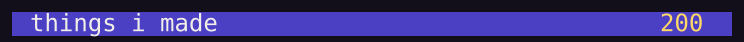<a href="https://incidentenkaart.nl">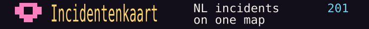</a><a href="https://crossyrivals.com">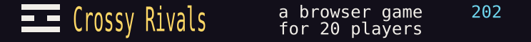</a><a href="https://sprinklegrid.nl">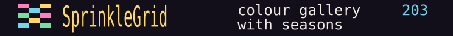</a><a href="https://github.com/TheDutchSmoke/sofastream">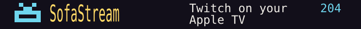</a><a href="https://myselfhosted.eu">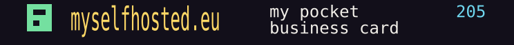</a> 

<!-- /live:projects -->

<!-- live:board -->
<!-- /live:board -->

<!-- live:lately -->

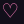 &nbsp;<a href="https://github.com/KartikLabhshetwar/better-shot/pull/199"><b>better-shot</b> #199</a> &nbsp;Fix deleting share links created with direct file links 
 &nbsp;<a href="https://github.com/giovannicoppola/alfred-aeye/pull/4"><b>alfred-aeye</b> #4</a> &nbsp;Show the Claude Fable weekly limit as its own row (0.3.0) 
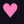 &nbsp;<a href="https://github.com/crmne/zapfast/pull/770"><b>zapfast</b> #770</a> &nbsp;Add Dutch interface translation 
 &nbsp;<a href="https://github.com/crmne/fastframe/pull/70"><b>fastframe</b> #70</a> &nbsp;Use Metal as the first renderer on macOS with wgpu

and more in <a href="https://github.com/KartikLabhshetwar/better-shot/pulls?q=is%3Apr+author%3ATheDutchSmoke">better-shot</a> · <a href="https://github.com/giovannicoppola/alfred-aeye/pulls?q=is%3Apr+author%3ATheDutchSmoke">alfred-aeye</a> · <a href="https://github.com/crmne/zapfast/pulls?q=is%3Apr+author%3ATheDutchSmoke">zapfast</a> · <a href="https://github.com/crmne/fastframe/pulls?q=is%3Apr+author%3ATheDutchSmoke">fastframe</a> · <a href="https://github.com/crmne/spotifast/pulls?q=is%3Apr+author%3ATheDutchSmoke">spotifast</a> · <a href="https://github.com/bilipp/Lume/pulls?q=is%3Apr+author%3ATheDutchSmoke">Lume</a> · <a href="https://github.com/crmne/winit/pulls?q=is%3Apr+author%3ATheDutchSmoke">winit</a> · <a href="https://github.com/bilipp/LumeCloud/pulls?q=is%3Apr+author%3ATheDutchSmoke">LumeCloud</a> · <a href="https://github.com/SakuraCordApp/SakuraCord/pulls?q=is%3Apr+author%3ATheDutchSmoke">SakuraCord</a> · <a href="https://github.com/chojs23/concord/pulls?q=is%3Apr+author%3ATheDutchSmoke">concord</a> · <a href="https://github.com/espanso/espanso/pulls?q=is%3Apr+author%3ATheDutchSmoke">espanso</a>

<!-- /live:lately -->

<!-- live:footer -->

&thinsp;&thinsp;&thinsp;<a href="https://github.com/TheDutchSmoke/TheDutchSmoke/issues/new?title=%E2%99%A5&body=Just+press+the+green+button+below+and+the+page+gets+a+heart+from+you.&labels=heart">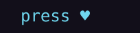</a>

<!-- /live:footer -->
