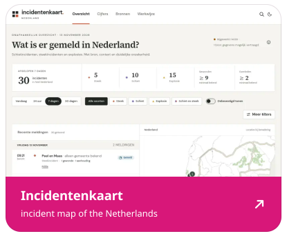
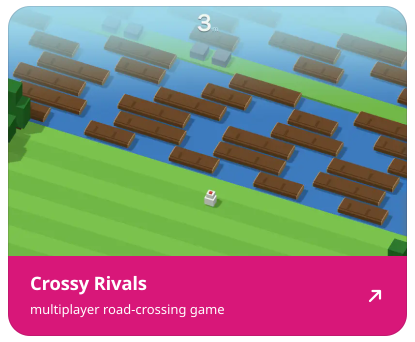
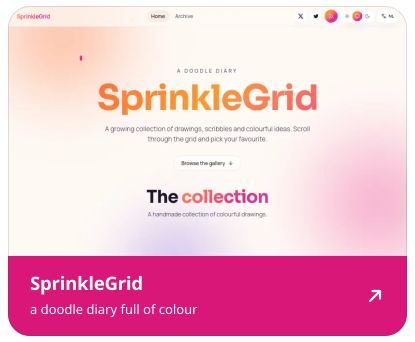
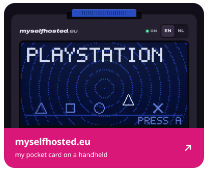

<!-- live:header -->
<picture><source media="(prefers-color-scheme: dark) and (max-width: 600px)" srcset="assets/header-narrow-dark.svg"><source media="(max-width: 600px)" srcset="assets/header-narrow-light.svg"><source media="(prefers-color-scheme: dark)" srcset="assets/header-dark.svg"></picture>
<!-- /live:header -->

<!-- live:tiles -->

And <a href="https://github.com/TheDutchSmoke/sofastream">SofaStream</a>, which has no site to show: it puts Twitch on the Apple TV from a macOS terminal.

<!-- /live:tiles -->

<!-- live:lately -->

I also like helping out in other people's projects: 
<a href="https://github.com/KartikLabhshetwar/better-shot/pulls?q=is%3Apr+author%3ATheDutchSmoke">better-shot</a> · <a href="https://github.com/giovannicoppola/alfred-aeye/pulls?q=is%3Apr+author%3ATheDutchSmoke">alfred-aeye</a> · <a href="https://github.com/crmne/zapfast/pulls?q=is%3Apr+author%3ATheDutchSmoke">zapfast</a> · <a href="https://github.com/crmne/fastframe/pulls?q=is%3Apr+author%3ATheDutchSmoke">fastframe</a> · <a href="https://github.com/crmne/spotifast/pulls?q=is%3Apr+author%3ATheDutchSmoke">spotifast</a> · <a href="https://github.com/bilipp/Lume/pulls?q=is%3Apr+author%3ATheDutchSmoke">Lume</a> · <a href="https://github.com/crmne/winit/pulls?q=is%3Apr+author%3ATheDutchSmoke">winit</a> · <a href="https://github.com/bilipp/LumeCloud/pulls?q=is%3Apr+author%3ATheDutchSmoke">LumeCloud</a> · <a href="https://github.com/SakuraCordApp/SakuraCord/pulls?q=is%3Apr+author%3ATheDutchSmoke">SakuraCord</a> · <a href="https://github.com/chojs23/concord/pulls?q=is%3Apr+author%3ATheDutchSmoke">concord</a> · <a href="https://github.com/espanso/espanso/pulls?q=is%3Apr+author%3ATheDutchSmoke">espanso</a>

<!-- /live:lately -->

say hi: <a href="https://myselfhosted.eu">myselfhosted.eu</a> ♡

