<!-- live:board -->

<picture><source media="(prefers-color-scheme: dark) and (max-width: 520px)" srcset="assets/banner-narrow-dark.svg"><source media="(max-width: 520px)" srcset="assets/banner-narrow-light.svg"><source media="(prefers-color-scheme: dark)" srcset="assets/banner-dark.svg"></picture><a href="https://incidentenkaart.nl"><picture><source media="(prefers-color-scheme: dark) and (max-width: 520px)" srcset="assets/row-map-narrow-dark.svg"><source media="(max-width: 520px)" srcset="assets/row-map-narrow-light.svg"><source media="(prefers-color-scheme: dark)" srcset="assets/row-map-dark.svg"></picture></a><a href="https://crossyrivals.com"><picture><source media="(prefers-color-scheme: dark) and (max-width: 520px)" srcset="assets/row-road-narrow-dark.svg"><source media="(max-width: 520px)" srcset="assets/row-road-narrow-light.svg"><source media="(prefers-color-scheme: dark)" srcset="assets/row-road-dark.svg"></picture></a><a href="https://sprinklegrid.nl"><picture><source media="(prefers-color-scheme: dark) and (max-width: 520px)" srcset="assets/row-sprinkles-narrow-dark.svg"><source media="(max-width: 520px)" srcset="assets/row-sprinkles-narrow-light.svg"><source media="(prefers-color-scheme: dark)" srcset="assets/row-sprinkles-dark.svg"></picture></a><a href="https://github.com/TheDutchSmoke/sofastream"><picture><source media="(prefers-color-scheme: dark) and (max-width: 520px)" srcset="assets/row-tv-narrow-dark.svg"><source media="(max-width: 520px)" srcset="assets/row-tv-narrow-light.svg"><source media="(prefers-color-scheme: dark)" srcset="assets/row-tv-dark.svg"></picture></a><a href="https://myselfhosted.eu"><picture><source media="(prefers-color-scheme: dark) and (max-width: 520px)" srcset="assets/row-console-narrow-dark.svg"><source media="(max-width: 520px)" srcset="assets/row-console-narrow-light.svg"><source media="(prefers-color-scheme: dark)" srcset="assets/row-console-dark.svg"></picture></a> 

<!-- /live:board -->

I like having my own little corner of the internet and making it feel like mine. I run a couple of small servers, build tools and games for fun, and now and then translate an app I love into Dutch.

<!-- live:lately -->

I also like helping out in other people's projects: <b>7</b> pull requests merged, <b>9</b> still waiting. <a href="https://github.com/pulls?q=is%3Apr+author%3ATheDutchSmoke+is%3Apublic+-user%3ATheDutchSmoke">All of them</a>, and the newest:

 &nbsp;<a href="https://github.com/KartikLabhshetwar/better-shot/pull/199"><b>better-shot</b> #199</a> &nbsp;Fix deleting share links created with direct file links 
 &nbsp;<a href="https://github.com/crmne/zapfast/pull/770"><b>zapfast</b> #770</a> &nbsp;Add Dutch interface translation 
 &nbsp;<a href="https://github.com/crmne/fastframe/pull/70"><b>fastframe</b> #70</a> &nbsp;Use Metal as the first renderer on macOS with wgpu 
 &nbsp;<a href="https://github.com/crmne/spotifast/pull/1244"><b>spotifast</b> #1244</a> &nbsp;Use Metal for smoother scrolling on macOS

<!-- /live:lately -->

say hi: <a href="https://myselfhosted.eu">myselfhosted.eu</a> ♡

