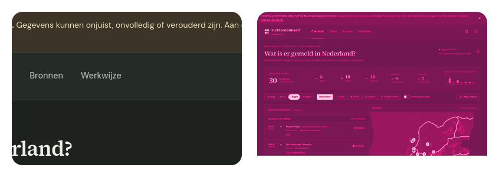

test 1: picture with width + scheme sources

<picture><source media="(prefers-color-scheme: dark) and (max-width: 600px)" srcset="narrow-dark.svg"><source media="(max-width: 600px)" srcset="narrow-light.svg"><source media="(prefers-color-scheme: dark)" srcset="wide-dark.svg"></picture>

test 2: raster embedded in svg, plain and duotone, panning

