<!-- live:hero -->
<picture><source media="(prefers-color-scheme: dark) and (max-width: 520px)" srcset="assets/hero-narrow-dark.svg"><source media="(max-width: 520px)" srcset="assets/hero-narrow-light.svg"><source media="(prefers-color-scheme: dark)" srcset="assets/hero-dark.svg"></picture>
<!-- /live:hero -->

The websites are <a href="https://incidentenkaart.nl">Incidentenkaart</a> (incidents in the Netherlands on one map), <a href="https://sprinklegrid.nl">SprinkleGrid</a> (a doodle diary) and <a href="https://myselfhosted.eu">myselfhosted.eu</a> (my pocket card). The game is <a href="https://crossyrivals.com">Crossy Rivals</a>, for up to 20 players. And there is <a href="https://github.com/TheDutchSmoke/sofastream">SofaStream</a>, which puts Twitch on the Apple TV from a Mac.

<!-- live:lately -->
<picture><source media="(prefers-color-scheme: dark) and (max-width: 520px)" srcset="assets/lately-narrow-dark.svg"><source media="(max-width: 520px)" srcset="assets/lately-narrow-light.svg"><source media="(prefers-color-scheme: dark)" srcset="assets/lately-dark.svg"></picture>

The newest: <a href="https://github.com/KartikLabhshetwar/better-shot/pull/199">better-shot&nbsp;#199</a>, <a href="https://github.com/giovannicoppola/alfred-aeye/pull/4">alfred-aeye&nbsp;#4</a> and <a href="https://github.com/crmne/spotifast/pull/1244">spotifast&nbsp;#1244</a> are still waiting, <a href="https://github.com/crmne/zapfast/pull/770">zapfast&nbsp;#770</a> and <a href="https://github.com/crmne/fastframe/pull/70">fastframe&nbsp;#70</a> got merged ♡. <a href="https://github.com/pulls?q=is%3Apr+author%3ATheDutchSmoke+is%3Apublic+-user%3ATheDutchSmoke">Here are all of them</a>.

<!-- /live:lately -->

say hi: <a href="https://myselfhosted.eu">myselfhosted.eu</a> ♡

