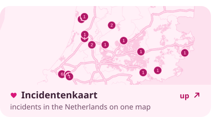
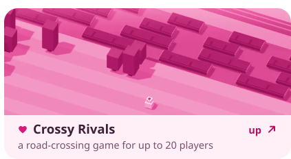
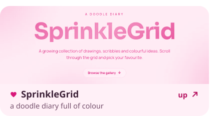
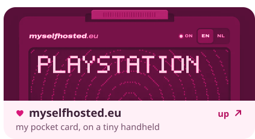

<!-- live:board -->

<picture><source media="(prefers-color-scheme: dark) and (max-width: 600px)" srcset="assets/hero-narrow-dark.svg"><source media="(max-width: 600px)" srcset="assets/hero-narrow-light.svg"><source media="(prefers-color-scheme: dark)" srcset="assets/hero-dark.svg"></picture><a href="https://incidentenkaart.nl"><picture><source media="(prefers-color-scheme: dark) and (max-width: 600px)" srcset="assets/tile-map-narrow-dark.svg"><source media="(max-width: 600px)" srcset="assets/tile-map-narrow-light.svg"><source media="(prefers-color-scheme: dark)" srcset="assets/tile-map-dark.svg"></picture></a><a href="https://crossyrivals.com"><picture><source media="(prefers-color-scheme: dark) and (max-width: 600px)" srcset="assets/tile-road-narrow-dark.svg"><source media="(max-width: 600px)" srcset="assets/tile-road-narrow-light.svg"><source media="(prefers-color-scheme: dark)" srcset="assets/tile-road-dark.svg"></picture></a><a href="https://sprinklegrid.nl"><picture><source media="(prefers-color-scheme: dark) and (max-width: 600px)" srcset="assets/tile-sprinkles-narrow-dark.svg"><source media="(max-width: 600px)" srcset="assets/tile-sprinkles-narrow-light.svg"><source media="(prefers-color-scheme: dark)" srcset="assets/tile-sprinkles-dark.svg"></picture></a><a href="https://myselfhosted.eu"><picture><source media="(prefers-color-scheme: dark) and (max-width: 600px)" srcset="assets/tile-console-narrow-dark.svg"><source media="(max-width: 600px)" srcset="assets/tile-console-narrow-light.svg"><source media="(prefers-color-scheme: dark)" srcset="assets/tile-console-dark.svg"></picture></a><a href="https://github.com/TheDutchSmoke/sofastream"><picture><source media="(prefers-color-scheme: dark) and (max-width: 600px)" srcset="assets/row-tv-narrow-dark.svg"><source media="(max-width: 600px)" srcset="assets/row-tv-narrow-light.svg"><source media="(prefers-color-scheme: dark)" srcset="assets/row-tv-dark.svg"></picture></a>

<!-- /live:board -->

<!-- live:lately -->
<picture><source media="(prefers-color-scheme: dark) and (max-width: 600px)" srcset="assets/helping-narrow-dark.svg"><source media="(max-width: 600px)" srcset="assets/helping-narrow-light.svg"><source media="(prefers-color-scheme: dark)" srcset="assets/helping-dark.svg"></picture>

The newest: <a href="https://github.com/KartikLabhshetwar/better-shot/pull/199">better-shot&nbsp;#199</a>, <a href="https://github.com/giovannicoppola/alfred-aeye/pull/4">alfred-aeye&nbsp;#4</a> and <a href="https://github.com/crmne/spotifast/pull/1244">spotifast&nbsp;#1244</a> are still waiting, <a href="https://github.com/crmne/zapfast/pull/770">zapfast&nbsp;#770</a> and <a href="https://github.com/crmne/fastframe/pull/70">fastframe&nbsp;#70</a> got merged ♡. Before those: <a href="https://github.com/bilipp/Lume/pulls?q=is%3Apr+author%3ATheDutchSmoke">Lume</a>, <a href="https://github.com/crmne/winit/pulls?q=is%3Apr+author%3ATheDutchSmoke">winit</a>, <a href="https://github.com/bilipp/LumeCloud/pulls?q=is%3Apr+author%3ATheDutchSmoke">LumeCloud</a>, <a href="https://github.com/SakuraCordApp/SakuraCord/pulls?q=is%3Apr+author%3ATheDutchSmoke">SakuraCord</a>, <a href="https://github.com/chojs23/concord/pulls?q=is%3Apr+author%3ATheDutchSmoke">concord</a> and <a href="https://github.com/espanso/espanso/pulls?q=is%3Apr+author%3ATheDutchSmoke">espanso</a>. <a href="https://github.com/pulls?q=is%3Apr+author%3ATheDutchSmoke+is%3Apublic+-user%3ATheDutchSmoke">Here are all of them</a>.

<!-- /live:lately -->

say hi: <a href="https://myselfhosted.eu">myselfhosted.eu</a> ♡

