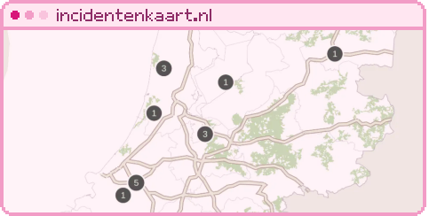

<!-- live:corner -->

<picture><source media="(prefers-color-scheme: dark) and (max-width: 600px)" srcset="assets/computer-narrow-dark.svg"><source media="(max-width: 600px)" srcset="assets/computer-narrow-light.svg"><source media="(prefers-color-scheme: dark)" srcset="assets/computer-dark.svg"></picture>I like having my own little corner of the internet and making it feel like mine. I run a couple of small servers, build tools and games for fun, and now and then translate an app I love into Dutch.

<ul>
<li><a href="https://incidentenkaart.nl">Incidentenkaart</a> incident map</li>
<li><a href="https://crossyrivals.com">Crossy Rivals</a> browser game</li>
<li><a href="https://sprinklegrid.nl">SprinkleGrid</a> colour gallery</li>
<li><a href="https://github.com/TheDutchSmoke/sofastream">SofaStream</a> Twitch on TV</li>
<li><a href="https://myselfhosted.eu">myselfhosted.eu</a> pocket card </li>
</ul>

<a href="https://incidentenkaart.nl"><picture><source media="(prefers-color-scheme: dark) and (max-width: 600px)" srcset="assets/site-map-narrow-dark.svg"><source media="(max-width: 600px)" srcset="assets/site-map-narrow-light.svg"><source media="(prefers-color-scheme: dark)" srcset="assets/site-map-dark.svg"></picture></a><a href="https://crossyrivals.com"><picture><source media="(prefers-color-scheme: dark) and (max-width: 600px)" srcset="assets/site-road-narrow-dark.svg"><source media="(max-width: 600px)" srcset="assets/site-road-narrow-light.svg"><source media="(prefers-color-scheme: dark)" srcset="assets/site-road-dark.svg"></picture></a>

<!-- /live:corner -->

<!-- live:helping -->

7 pull requests merged and 9 still waiting in other people's projects: <a href="https://github.com/KartikLabhshetwar/better-shot/pulls?q=is%3Apr+author%3ATheDutchSmoke">better-shot</a> · <a href="https://github.com/giovannicoppola/alfred-aeye/pulls?q=is%3Apr+author%3ATheDutchSmoke">alfred-aeye</a> · <a href="https://github.com/crmne/zapfast/pulls?q=is%3Apr+author%3ATheDutchSmoke">zapfast</a> · <a href="https://github.com/crmne/fastframe/pulls?q=is%3Apr+author%3ATheDutchSmoke">fastframe</a> · <a href="https://github.com/crmne/spotifast/pulls?q=is%3Apr+author%3ATheDutchSmoke">spotifast</a> · <a href="https://github.com/bilipp/Lume/pulls?q=is%3Apr+author%3ATheDutchSmoke">Lume</a> · <a href="https://github.com/crmne/winit/pulls?q=is%3Apr+author%3ATheDutchSmoke">winit</a> · <a href="https://github.com/bilipp/LumeCloud/pulls?q=is%3Apr+author%3ATheDutchSmoke">LumeCloud</a> · <a href="https://github.com/SakuraCordApp/SakuraCord/pulls?q=is%3Apr+author%3ATheDutchSmoke">SakuraCord</a> · <a href="https://github.com/chojs23/concord/pulls?q=is%3Apr+author%3ATheDutchSmoke">concord</a> · <a href="https://github.com/espanso/espanso/pulls?q=is%3Apr+author%3ATheDutchSmoke">espanso</a>

<!-- /live:helping -->

<!-- live:hi -->

<a href="https://myselfhosted.eu"><picture><source media="(prefers-color-scheme: dark) and (max-width: 600px)" srcset="assets/site-console-narrow-dark.svg"><source media="(max-width: 600px)" srcset="assets/site-console-narrow-light.svg"><source media="(prefers-color-scheme: dark)" srcset="assets/site-console-dark.svg"></picture></a>&nbsp;&nbsp; say&nbsp;hi:&nbsp;<a href="https://myselfhosted.eu">myselfhosted.eu</a>&nbsp;♡

<!-- /live:hi -->
